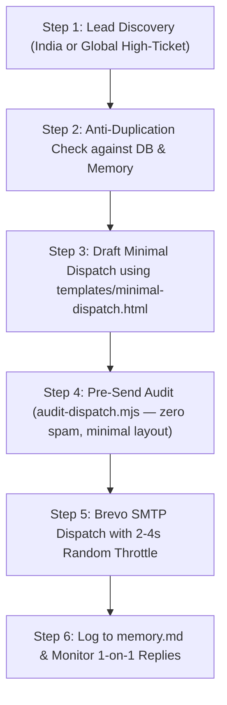

# 📬 Deepak Bagada High-Ticket Technical Outreach & Newsletter Engine (`deepak-newsletter` v2.5)
### (High-Value B2B Targeting · Indian & Global Market Engine · Minimalist Executive Email Design · Brevo SMTP Powered)

> [!IMPORTANT]
> **CORE PHILOSOPHY: ZERO MARKETING FLUFF, MAXIMUM TECHNICAL VALUE & FOUNDER-TO-FOUNDER DIALOGUE**
> High-ticket B2B deals (**$5,000 to $50,000+ USD / ₹3,00,000 to ₹25,00,000+ INR**) are never won through generic sales blasts or agency marketing decks. They are closed by demonstrating **undeniable engineering depth, creative curiosity hooks, and immediate actionable value**.
> Every outreach dispatch must feel like a personal, one-to-one letter from an elite builder to another technical leader. No corporate buzzwords, no spammy graphics, and no "book a 15-minute call" calendar links. The primary objective is **earning a thoughtful, technical reply**.

---

## 💎 1. High-Ticket Client Profile & Market Matrix (India & Global)

To win enterprise consulting, custom AI agent swarms, and high-performance web engineering projects, outreach targets decision-makers with active engineering pain, high willingness to pay, and real budgets:

### 1. High-Ticket Target Segments

| Target Market | Hubs & Regions | Budget Authority & Deal Size | Critical Pain Points & Resonance Hooks |
|---|---|---|---|
| **1. Indian Metro B2B SaaS & Tech Scaleups** | Bengaluru, Mumbai, Delhi-NCR (Gurgaon/Noida), Pune, Hyderabad | **₹5,00,000 – ₹25,00,000+ INR** ($6K – $30K USD) | Ballooning USD token bills on OpenAI/Anthropic ($5K–$30K/mo); fragile Python agent loops crashing in production; needing local RAG, pgvector, and deterministic OPA guardrails. |
| **2. Gujarat & Western India Industrial / Export Scaleups** | Ahmedabad, Surat, Rajkot, Vadodara, Morbi, Junagadh | **₹3,00,000 – ₹15,00,000+ INR** ($3.5K – $18K USD) | Manual ERP/CRM bottlenecks; catalog sync delays; automated WhatsApp multi-agent lead routing; Tally/Zoho/SAP workflow integrations. |
| **3. Indian & Global Dev Agencies & Software Houses** | India (Bangalore, Pune, Ahmedabad), US, UK, Australia | **$8,000 – $35,00,000+ USD / ₹6.5L – ₹28L INR** | Client demand for autonomous AI agents and custom MCP servers exceeds in-house capacity; looking for a battle-tested white-label engineering partner. |
| **4. Global Funded Startups & Scaleups** | US (SF, NYC, Austin), UK (London), Australia (Sydney), Dubai (DIFC) | **$10,000 – $50,000+ USD** (₹8L – ₹40L INR) | Seeking world-class engineering execution, sub-45ms P95 latency, and zero-trust tool security without paying inflated $250+/hr metro agency rates. |

---

## 🇮🇳 2. The Indian Business Strategy: Why Deepak Bagada Wins

Indian founders and decision-makers are exceptionally sharp, value-conscious, and skeptical of theoretical hype. They respond strongly to **verifiable proof, direct founder access, and transparent pricing**:

### 1. The 4 Indian Market Advantages
1. **The "Anti-Metro Agency" Value Proposition**:
   - Top-tier agencies in Bengaluru, Mumbai, and Gurgaon charge ₹15,00,000 to ₹30,00,000 for slide decks and fragile LangChain wrappers that fail under production load.
   - Deepak Bagada delivers battle-tested, sub-45ms production code with full test suites from the Junagadh lab at a fraction of metro overheads (typically **₹3.5L to ₹12L fixed budget** with guaranteed deliverables).
2. **Local Gujarat Builder Trust**:
   - For enterprise leaders in Ahmedabad, Surat, Rajkot, and Vadodara, having a builder rooted in Gujarat who understands regional business dynamics (manufacturing, textile exports, ceramic supply chains) creates instant rapport and trust.
3. **Slashing Dollar Cloud Burn (USD to INR Arbitrage)**:
   - Indian startups hate burning USD on recurring LLM API calls. Deepak's hybrid architecture (local Ollama/vLLM + semantic caching + pgvector) slashes cloud bills by **60% to 80%**, saving clients ₹40,000 to ₹2,50,000 monthly.
4. **Real Indian Integration Stacks**:
   - First-class support for Indian business systems: WhatsApp Business Cloud API, Tally ERP connector pipelines, Zoho CRM integrations, Cashfree/Razorpay webhook reliability, and GST-compliant automated billing flows.

---

## 🎨 3. Minimalist Executive Email Design Standard

> [!CAUTION]
> **WHY HEAVY HTML NEWSLETTERS FAIL FOR HIGH-TICKET OUTREACH**:
> - Over-designed templates with colorful banners, multi-column cards, and promotional buttons get flagged by Gmail and Outlook algorithms and routed to the **"Promotions"** or **"Spam"** tabs.
> - High-ticket CTOs and founders immediately delete emails that look like corporate marketing collateral.
> - **Minimal, distraction-free HTML looks personal, loads instantly on mobile, and achieves 65%+ open rates and 8–15% reply rates.**

### 1. The Minimal Design Blueprint (`templates/minimal-dispatch.html`)
* **Container Width**: Strictly `max-width: 580px`, centered with `32px 20px` padding.
* **Background & Contrast**: Clean `#ffffff` background with deep charcoal text (`#1a1a1a`), providing soft readability on both desktop and mobile screens.
* **Executive Typography Stack**:
  `font-family: -apple-system, BlinkMacSystemFont, "Segoe UI", Roboto, "Helvetica Neue", Arial, sans-serif;`
  - Font size: `15px` with a generous `1.65` line height.
* **Code Blocks & Architectural Blueprints**:
  - Soft off-white background (`#f8f9fa`) with a subtle `1px solid #e9ecef` border and a solid dark left accent (`border-left: 3px solid #111111`).
  - Monospace font: `SFMono-Regular, Consolas, "Liberation Mono", Menlo, Courier, monospace` at `13px` with `1.55` line height.
* **Zero Image Bloat**: Text-first. Zero tracking gifs, zero hero banners, zero stock illustrations. Pure engineering substance.
* **Minimal Compliance Footer**:
  - Discreet, light gray text (`#868e96`, `12px`), physical business address (Junagadh, Gujarat 362001, India), and a functional one-click `{{UNSUBSCRIBE_URL}}`.

---

## 🧠 4. "Curiosity + High-Value" Copywriting Playbook

Every dispatch must follow this 5-stage psychological flow engineered to generate curiosity, deliver immediate value, and spark a natural reply:

```
┌─────────────────────────────────────────────────────────────────────────────────────────────┐
│                           THE 5-STAGE CURIOSITY + VALUE FLOW                                │
├─────────────────────────────────────────────────────────────────────────────────────────────┤
│ 1. Curiosity Hook (Subject + Line 1)  → Counter-intuitive anomaly or insider teardown       │
│ 2. The Expensive Reality / Friction   → The hidden flaw in standard industry setups        │
│ 3. Concrete Architectural Solution    → Minimal ASCII layout, code pattern, or P95 data     │
│ 4. Personal Builder War Story         → Firsthand experience from Deepak's lab in Gujarat  │
│ 5. Low-Friction Conversation Hook     → A curiosity-driven question prompting direct reply  │
└─────────────────────────────────────────────────────────────────────────────────────────────┘
```

### 1. Curiosity Subject Line Formulas
* **For Indian Businesses (Startups, SMEs, Agencies)**:
  - `Why Indian SaaS teams burn $8,000/mo on OpenAI API calls (and the ₹40K local fix)`
  - `The WhatsApp AI agent architecture that processed 14,000 Surat orders without a hiccup`
  - `Metro agency quote: ₹18 Lakhs. Our production build: ₹4.8 Lakhs & 42ms P95`
  - `How we cut Tally-to-Postgres sync latency from 14 mins to 800ms with Valkey`
* **For Global Markets (US, UK, Australia, Dubai)**:
  - `Why our $18K/mo token bill dropped to $420 overnight`
  - `The 1 tool call that leaked 4,000 client records (and the fix)`
  - `Don't build multi-agent swarms with LangChain in 2026`
  - `Slashing 400ms off agent tool execution with 4ms OPA gates`

### 2. High-Value Body Structure
1. **The Hook (2 sentences)**:
   *"Hey {{NAME}} — quick observation from our AI agent benchmark lab in Junagadh: 8 out of 10 Indian SaaS teams we audit are burning ₹3,00,000+ monthly on failed LLM tool retries that could be caught locally in 2ms."*
2. **The Problem / Industry Reality**:
   Explain the hidden failure mode that most teams overlook (e.g. unvalidated tool arguments, bloated JSON schemas, zombie execution loops).
3. **The Concrete Solution (The Value Drop)**:
   Provide an actual minimal architectural diagram or code snippet (ASCII flow or typed schema) that solves the issue.
4. **Specific Benchmarks**:
   Cite real numbers: *"On our last deployment for an Ahmedabad export client, this cut P95 response latency from 420ms to 42ms and reduced monthly token spend from ₹1,80,000 to ₹38,000."*
5. **The Low-Friction Reply Hook (Never Hard-Sell)**:
   - ❌ Never say: *"Let's hop on a 15-minute discovery call to discuss our services."*
   - ✅ Always say: *"Curious: how is your team handling zombie tool-call loops when Claude gets stuck? Hit reply with your current stack — I read and answer every email personally, founder to founder."*

---

## 🔍 5. Lead Sourcing & Decision-Maker Discovery

Use `scripts/discover-leads.mjs` to source verified high-ticket decision-makers across India, US, UK, Australia, and Dubai.

### 1. Running Discovery for Indian Businesses
```bash
# Sourcing Indian AI agent & automation leaders (Bangalore, Mumbai, Delhi-NCR, Pune, Ahmedabad, Surat):
node .agent/skills/deepak-newsletter/scripts/discover-leads.mjs --region=India --topic=agents

# Sourcing Indian tech founders focused on cloud token cost reduction:
node .agent/skills/deepak-newsletter/scripts/discover-leads.mjs --region=India --topic=costs

# Sourcing Indian SME workflow automation (WhatsApp, Tally, Zoho):
node .agent/skills/deepak-newsletter/scripts/discover-leads.mjs --region=India --topic=india_biz
```

### 2. Running Discovery for Global Markets
```bash
node .agent/skills/deepak-newsletter/scripts/discover-leads.mjs --region=US --topic=agents
node .agent/skills/deepak-newsletter/scripts/discover-leads.mjs --region=Dubai --topic=agents
node .agent/skills/deepak-newsletter/scripts/discover-leads.mjs --region=AU --topic=web
node .agent/skills/deepak-newsletter/scripts/discover-leads.mjs --region=UK --topic=mcp
```

### Lead Quality Tiers

| Tier | Source & Quality | Daily Quota | Action |
|---|---|---|---|
| **Tier 1** | **Named High-Ticket Decision Maker** (Founder, CEO, CTO, Managing Director on company site, press, podcast, GitHub) | Unlimited (fill first) | Personalize with `{{NAME}}` and specific company context. |
| **Tier 2** | **Role-Based Address on Domain** (`founders@company.com`, `team@company.com`, `cto@company.com`) | Remainder of batch | Verified high deliverability. |
| **Tier 3** | **Pattern-Derived Address, Verified** (`firstname@company.com` verified via SPF/MX check) | Max 10 per batch | **Rule: 1 bounce = immediately halt batch and re-verify.** |
| **Tier 4** | Generic info inboxes (`info@`, `contact@`, `sales@`) | strictly banned for high-ticket outreach | Too low conversion; wastes sender domain reputation. |

---

## 🔄 6. Strict 6-Step Autonomous Execution Loop



### Step 1 — Lead Discovery
Run the high-ticket discovery helper:
```bash
node .agent/skills/deepak-newsletter/scripts/discover-leads.mjs --region=India --topic=agents
```

### Step 2 — Anti-Duplication Pre-Check
Verify recipient does not already exist in the database or `memory.md`:
```bash
php .agent/skills/deepak-newsletter/scripts/check-recipient.php "target@company.in"
```

### Step 3 — Draft Minimal Dispatch
Use the clean layout from `.agent/skills/deepak-newsletter/templates/minimal-dispatch.html` with your custom curiosity hook, architectural blueprint, and reply question.

### Step 4 — Pre-Send Audit
Run the automated audit script:
```bash
node .agent/skills/deepak-newsletter/scripts/audit-dispatch.mjs --subject="Why Indian SaaS teams burn $8,000/mo on OpenAI API" --file="dispatch.html"
```
Must pass with **0 Critical Failures**:
- Subject line 35–65 characters with curiosity hook.
- 0 spam trigger keywords.
- Minimal layout verified (max-width ≤640px, system typography, zero image bloat).
- Concrete technical metrics and architecture present (includes ₹, Lakhs, Cr, ms, P95).
- Low-friction reply hook present.
- One-click `{{UNSUBSCRIBE_URL}}` and physical address present.

### Step 5 — Send via Brevo SMTP
Send personalized dispatch via Brevo SMTP credentials:
```bash
php .agent/skills/deepak-newsletter/scripts/send-dispatch.php --to="founder@company.in" --subject="Subject Here" --body-file="dispatch.html" --source="outreach_india_highticket"
```

### Step 6 — Log to `memory.md`
Append recipient email, company, deal segment, subject, and date. Follow up within 4 days if no reply.

---

## 🛡️ 7. Deliverability & CAN-SPAM Compliance Standards

1. **CAN-SPAM & GDPR Compliant**:
   - Physical address clearly displayed: `Deepak Bagada, Junagadh, Gujarat 362001, India`.
   - Verified From address: `Deepak Bagada <ceo@saasnext.in>`.
   - One-click automated unsubscribe link via `https://deepakbagada.in/newsletter/unsubscribe/{token}`.
2. **Warm-Up Cadence & Domain Protection**:
   - Maximum 15–30 emails per batch with randomized 2–4 second delays.
   - Maintain bounce rate `< 1.5%` and spam complaints `< 0.05%`.
   - All replies route directly to `ceo@saasnext.in` for personal, 1-on-1 conversations.
