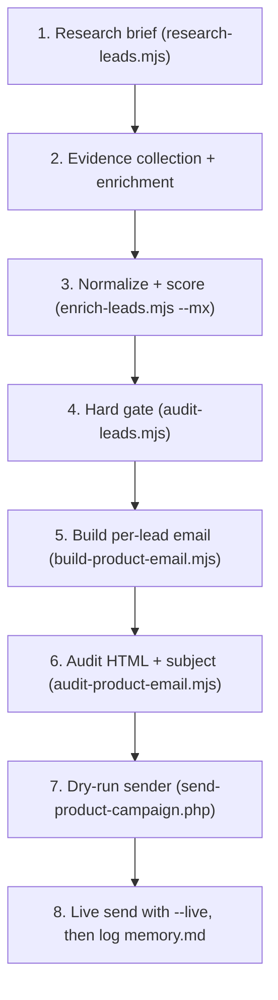

# Deepak Bagada Metro Outreach & Newsletter Engine (`deepak-newsletter` v3.0)

## Core philosophy

Sell the product first. The paid toolkit is the low-friction entry point; the custom build is the reply conversation, not the pitch.

Every email must read like a one-to-one note from an operator who has shipped the work. No agency deck language, no calendar links, no fake urgency, no generic "I hope this email finds you well." The objective is a technical reply or a product purchase, not a "discovery call."

Primary market: **Indian metro cities**. Secondary: **Gujarat industrial belt**. Global outreach remains available but is not the default.

---

## 1. Market matrix

### 1.1 Metro targeting matrix

| Metro | Priority | Sectors | Decision-makers | Pain hooks | Best-fit products |
|---|---|---|---|---|---|
| **Bengaluru** | P1 | B2B SaaS, AI infra, dev tools, fintech, D2C | Founder, Co-Founder, CTO, VP Engineering, Head of AI | Token spend outrunning ARR; agent retries; context drift across CLAUDE.md/Cursor rules; MCP servers without security gates | AI Systems Master Bundle, MCP Server Launch Kit, Agent Context Architect |
| **Mumbai** | P1 | Fintech, BFSI, D2C, media, enterprise SaaS | Founder, MD, CTO, Head of Digital | Compliance-heavy agent workflows; payment webhook reconciliation; WhatsApp support volume; agency scope creep | GST Invoice & HSN Compliance Kit, AI Agency Delivery OS, n8n Production Hardening Pack |
| **Delhi NCR** | P1 | SaaS, edtech, healthtech, agencies, public-sector tech | Founder, Co-Founder, CTO, VP Engineering, Director of Technology | Enterprise security reviews stalling pilots; Tally/Zoho/SAP integration breaks; token cost after every prompt change | AI Systems Master Bundle, MCP Server Launch Kit, AI Agency Delivery OS |
| **Pune** | P2 | Engineering services, manufacturing tech, SaaS, automotive, agencies | Founder, CTO, VP Engineering, Delivery Head | Repeated agent scaffolding across clients; ERP data trapped in Excel; silent n8n failures; proposal rework | AI Agency Delivery OS, n8n Production Hardening Pack, AI Systems Master Bundle |
| **Hyderabad** | P2 | Enterprise SaaS, pharma tech, AI services, BFSI, GCCs | Founder, CTO, VP Engineering, Head of AI | Global client security reviews; manual agent regression testing; USD token bills; conflicting coding-agent rules | MCP Server Launch Kit, Agent Context Architect, AI Systems Master Bundle |
| **Chennai** | P2 | SaaS, manufacturing, logistics, healthcare, IT services | Founder, CTO, Head of Technology, Delivery Director | Logistics retries; white-label AI delivery assets; manual GST checks; missing handover runbooks | AI Agency Delivery OS, GST Invoice & HSN Compliance Kit, n8n Production Hardening Pack |
| **Kolkata** | P2 | Agencies, D2C, edtech, manufacturing, IT services | Founder, MD, CTO, Head of Digital | Underpriced agency delivery; manual client reporting; WhatsApp commerce peak failures; AI pilots stuck before sign-off | AI Agency Delivery OS, n8n Production Hardening Pack, Agent Context Architect |
| **Ahmedabad** | P2 | Manufacturing, textiles, chemicals, pharma, D2C, agencies | Founder, MD, CTO, Head of IT, Export Head | Catalogue/ERP sync delays; Tally-to-Postgres errors; manual export documentation; agency scope leaks | n8n Production Hardening Pack, GST Invoice & HSN Compliance Kit, AI Agency Delivery OS |

City canonicalization is enforced by `enrich-leads.mjs`:

- Bangalore / BLR → **Bengaluru**
- Bombay / Thane / Navi Mumbai → **Mumbai**
- Delhi / New Delhi / Gurgaon / Gurugram / Noida / Faridabad / Ghaziabad → **Delhi NCR**
- Madras / OMR → **Chennai**
- Calcutta / Salt Lake / New Town → **Kolkata**
- Gandhinagar / Amdavad → **Ahmedabad**

Non-metro leads are allowed only when `--allow-non-metro` is passed to the sender. Default is metro-only.

### 1.2 Gujarat secondary market

Ahmedabad is the metro entry point. Surat, Rajkot, Vadodara and Morbi are secondary and should be used only after the metro batch is exhausted. Product fit is usually n8n Production Hardening Pack, GST Invoice & HSN Compliance Kit or AI Agency Delivery OS.

### 1.3 Product catalog

| Product | Price | Compare | Storefront | Best for |
|---|---:|---:|---|---|
| The AI Systems Master Bundle | ₹9,999 | ₹19,999 | `/products/agent-skills-master-bundle` | Founders and CTOs who want all four engineering toolkits |
| AI Agency Delivery OS | ₹5,999 | ₹11,999 | `/products/agency-delivery-os` | Agencies and software houses fighting scope creep |
| MCP Server Launch Kit | ₹3,499 | ₹6,999 | `/products/mcp-server-launch-kit` | Teams shipping MCP servers without security gates |
| Agent Context Architect | ₹2,999 | ₹5,999 | `/products/agent-context-architect` | Teams with CLAUDE.md / Cursor / AGENTS.md drift |
| n8n Production Hardening Pack | ₹2,499 | ₹4,999 | `/products/n8n-hardening-pack` | Automation teams with silent workflow failures |
| GST Invoice & HSN Compliance Kit | ₹1,499 | ₹3,999 | `/products/gst-invoice-compliance-kit` | Finance and compliance teams |
| ITC Recovery Desk | ₹1,499 | ₹3,999 | `/products/itc-recovery-desk` | Teams reconciling GSTR-2B and blocked ITC |
| Ad Creative Lab | ₹999 | ₹1,499 | `/products/ad-creative-lab` | Performance marketers testing ad copy |
| Content Repurpose Engine | ₹899 | ₹2,499 | `/products/content-repurpose-engine` | Founders and creators repurposing one asset |
| India Offer & Pricing Kit | ₹699 | ₹1,999 | `/products/india-offer-pricing-kit` | Solo consultants pricing Indian offers |

Prices live in `config/products.php`. Never hardcode a price into copy without checking the catalog.

---

## 2. Deep research and enrichment pipeline

The old workflow generated Boolean queries and stopped. v3.0 requires evidence, scoring and a hard audit before any email is drafted.

### 2.1 Stage commands

```bash
# 1. Generate the metro research brief and search plan
node .agent/skills/deepak-newsletter/scripts/research-leads.mjs \
  --metro=all --segment=agency --topic=context --count=25

# 2. Run the queries with web search. Fill the enrichment contract.
#    Save raw leads as research/leads-YYYY-MM-DD.json

# 3. Normalize, score, dedupe and optionally verify MX
node .agent/skills/deepak-newsletter/scripts/enrich-leads.mjs \
  --in research/leads-2026-10-25.json \
  --out research/leads-2026-10-25-enriched.json --mx

# 4. Hard gate: metro, decision-maker, email hygiene, source, hook, score
node .agent/skills/deepak-newsletter/scripts/audit-leads.mjs \
  --file research/leads-2026-10-25-enriched.json \
  --min-score=65 --metro-only
```

`audit-leads.mjs` exits `1` on any critical failure. Do not proceed to drafting until it passes.

### 2.2 Evidence standard

Every lead needs one public, dated, verifiable signal:

- funding round (Inc42, YourStory, Entrackr, company blog)
- AI or engineering hiring (company careers page, Wellfound, Instahyre, LinkedIn post)
- product launch or migration (company blog, changelog, GitHub release)
- compliance deadline, security review, or public post from the decision-maker

Banned sources: Apollo, ZoomInfo, Lusha, scraped databases, guessed email patterns, and anything the agent cannot open in a browser.

### 2.3 Enrichment contract

Required fields:

```json
{
  "id": "BLR-AGENCY-001",
  "company": "Acme Studio",
  "domain": "acmestudio.in",
  "website": "https://acmestudio.in",
  "email": "asha@acmestudio.in",
  "name": "Asha Rao",
  "first_name": "Asha",
  "title": "Co-Founder",
  "role_tier": "founder",
  "city": "Bengaluru",
  "metro": true,
  "segment": "agency",
  "niche": "AI product studio for B2B SaaS",
  "source_url": "https://acmestudio.in/about",
  "signal": "Raised a seed round in September 2026 and is hiring AI engineers",
  "tech_stack": ["Next.js", "Postgres", "OpenAI"],
  "pain_hypothesis": "Delivery scope expands faster than the proposal, so senior time leaks into unbilled revisions.",
  "personalization_hook": "Asha, saw Acme Studio raised a seed round and is hiring AI engineers for its product studio.",
  "why_now": "Seed round plus AI hiring plus a growing client portfolio.",
  "product_fit": "AI Agency Delivery OS",
  "research_score": 88,
  "tier": "A",
  "email_status": "valid",
  "mx": true,
  "quality_flags": [],
  "researched_at": "2026-10-25"
}
```

Rules:

- `personalization_hook` is the literal first line of the email. It must name a real, specific detail.
- `pain_hypothesis` is one sentence, tied to the signal and the product.
- `product_fit` must match an actual catalog product.
- `research_score` is computed by `enrich-leads.mjs`. Do not hand-write it.
- `tier` is A ≥ 80, B ≥ 65, C ≥ 50, D < 50. Send only A/B.

### 2.4 Scoring rubric (0–100)

| Dimension | Max | Rules |
|---|---:|---|
| Fit | 25 | Metro +15; segment match +10; adjacent segment +4 |
| Pain | 25 | Named pain hypothesis +10; trigger signal +10; product fit mapped +5 |
| Authority | 20 | Founder/CEO/MD +20; CTO/VP/Head +18; Director +14; Manager +9; Unknown +3 |
| Reachability | 20 | Valid email +4; company-domain email +6; named person +4; MX verified +3; generic inbox −8; free inbox −4 |
| Timing | 10 | Funding +5; hiring +4; launch +3; migration +3; cost/compliance trigger +3 |

### 2.5 Quality gates

- Metro city only.
- Named decision-maker or role-based company email. No `info@`, `contact@`, `hello@`, `sales@`, `support@`.
- Public `https` source URL.
- Dated signal within 90 days.
- Personalization hook at least 30 characters and specific.
- Score ≥ 65 for Tier B, ≥ 80 for Tier A.
- MX must resolve for sendable domains. `mx: false` is a hard fail.
- One bounce halts the batch. Re-verify before resuming.

---

## 3. Email design standards

### 3.1 Minimal dispatch (consulting / relationship)

Use `templates/minimal-dispatch.html` for a personal technical letter.

- Width: `max-width: 580px`
- Light background `#ffffff`, charcoal text `#1a1a1a`
- System font stack, 15px body, 1.65 line height
- Code blocks: off-white `#f8f9fa`, `1px solid #e9ecef`, dark left accent
- No images, no tracking pixels, no hero banners
- Footer: physical address and one-click unsubscribe

### 3.2 Dark product-sales email (default for product campaigns)

Use `templates/dark-product-sales.html` for the ₹699–₹9,999 toolkits.

| Element | Value |
|---|---|
| Page background | `#07090d` |
| Card background | `#0e1117` |
| Border | `#1f2630` |
| Heading | `#f0f6fc` |
| Body | `#c9d1d9` |
| Muted | `#9aa4b2` |
| Accent | `#7ee787` |
| CTA button | `#238636` with white text |
| Container | `max-width: 600px` |
| Font | `-apple-system, BlinkMacSystemFont, "Segoe UI", Roboto, Helvetica, Arial, sans-serif` |

Structure, in order:

1. Hidden preheader with the product outcome and price.
2. Brand line: `Deepak Bagada · SaaS Next` and `{{REGION}} · {{YEAR}}`.
3. Personalized hook, then pain hypothesis.
4. Green-tinted "The fix" callout with the product outcome.
5. Product name, tagline, price, compare price and price note.
6. One primary CTA to the product page.
7. "What you get" proof bullets.
8. Feature table: deliverables, license, format, updates.
9. Bonus / included block.
10. Guarantee.
11. P.S. reply prompt.
12. Sign-off, physical address, unsubscribe.

Hard rules:

- Zero `` tags, zero `<script>`, zero external stylesheets.
- One primary CTA. Product links may appear at most three times.
- Subject line 20–65 characters. No all caps, no `!!`, no fake urgency.
- No "Dear Sir/Madam", "I hope this email finds you well", "revolutionary", "game-changer", "cutting-edge".
- Price must be visible as `₹` and match the catalog.
- Unsubscribe and physical address are mandatory.

### 3.3 Product subject formulas

- `{{FIRST_NAME}}, stop scope creep before it eats your margin`
- `{{COMPANY}}: 10 phase-gated artifacts from one intake`
- `{{CITY}} agencies: deliver AI projects without scope leaks`
- `A ₹5,999 delivery OS for {{COMPANY}}`
- `{{FIRST_NAME}}, a ₹2,499 fix for silent n8n failures`
- `{{COMPANY}}: cut MCP security review time from weeks to days`

Keep the promise concrete. No "unlock", "transform", "10x" or "secret".

---

## 4. Copywriting playbook

### 4.1 Product email flow

```
Hook (specific signal about the company)
  → Pain (one sentence, tied to the signal)
  → Outcome (what the product changes)
  → Proof (3–5 concrete artifacts or benchmarks)
  → Price (transparent, with compare price)
  → CTA (one product link)
  → Guarantee (low-risk, specific)
  → P.S. (reply prompt, no call booking)
```

### 4.2 Consulting dispatch flow

1. Curiosity hook: counter-intuitive anomaly or insider teardown.
2. Expensive reality: the hidden failure mode in the standard setup.
3. Concrete solution: minimal architecture, code pattern or P95 benchmark.
4. Builder war story: firsthand result from the Junagadh lab.
5. Low-friction reply question.

### 4.3 Anti-fluff rules

- Ban: "I hope this email finds you well", "quick question", "revolutionary", "game-changer", "cutting-edge", "synergy", "circle back", "touch base", "world-class", "best-in-class", "unlock the power".
- Ban: "book a 15-minute call", Calendly links, "limited time", "act now", "risk-free".
- Every claim needs a number, an artifact, or a public source.
- Write at a 7th-grade reading level. Short sentences. No paragraph longer than three lines on mobile.
- One idea per email. One CTA per email.

---

## 5. Lead sourcing

### 5.1 Metro discovery

```bash
# All metros, agency segment
node .agent/skills/deepak-newsletter/scripts/discover-leads.mjs \
  --region=India --metro=all --segment=agency --topic=context

# Single metro, cost-reduction angle
node .agent/skills/deepak-newsletter/scripts/discover-leads.mjs \
  --region=India --metro=Bengaluru --segment=saas --topic=costs

# Delhi NCR fintech
node .agent/skills/deepak-newsletter/scripts/discover-leads.mjs \
  --region=India --metro="Delhi NCR" --segment=fintech --topic=india_biz
```

### 5.2 Global discovery (secondary)

```bash
node .agent/skills/deepak-newsletter/scripts/discover-leads.mjs --region=US --topic=agents
node .agent/skills/deepak-newsletter/scripts/discover-leads.mjs --region=Dubai --topic=agents
node .agent/skills/deepak-newsletter/scripts/discover-leads.mjs --region=AU --topic=web
node .agent/skills/deepak-newsletter/scripts/discover-leads.mjs --region=UK --topic=mcp
```

### 5.3 Lead quality tiers

| Tier | Source | Batch quota | Action |
|---|---|---|---|
| Tier 1 | Named decision-maker with public company email | Unlimited, fill first | Personalize with first name and a real signal |
| Tier 2 | Role-based company email (`founders@`, `cto@`, `team@`) | Remainder of batch | Verify MX before send |
| Tier 3 | Pattern-derived address, verified | Max 10 per batch | 1 bounce = halt and re-verify |
| Tier 4 | Generic inbox (`info@`, `contact@`, `hello@`) | Banned for product campaigns | Wastes domain reputation |

---

## 6. Execution loops

### 6.1 Product campaign loop (default)



Commands:

```bash
# Build one email per lead
node .agent/skills/deepak-newsletter/scripts/build-product-email.mjs \
  --product .agent/skills/deepak-newsletter/products/agency-delivery-os.json \
  --leads research/leads-2026-10-25-enriched.json \
  --out-dir campaigns/2026-10-25-agency

# Audit every built email
node .agent/skills/deepak-newsletter/scripts/audit-product-email.mjs \
  --manifest campaigns/2026-10-25-agency/manifest.json \
  --out campaigns/2026-10-25-agency/audit.md

# Dry run (default). Saves rendered HTML for inspection.
php .agent/skills/deepak-newsletter/scripts/send-product-campaign.php \
  --leads-file=research/leads-2026-10-25-enriched.json \
  --product-file=.agent/skills/deepak-newsletter/products/agency-delivery-os.json \
  --limit=10 --save-dir=campaigns/2026-10-25-agency/preview

# Live send only after the dry run and audits pass
php .agent/skills/deepak-newsletter/scripts/send-product-campaign.php \
  --leads-file=research/leads-2026-10-25-enriched.json \
  --product-file=.agent/skills/deepak-newsletter/products/agency-delivery-os.json \
  --limit=10 --sleep=4 --live --source=metro_agency_oct
```

Sender defaults:

- Dry-run unless `--live` is present.
- Metro-only unless `--allow-non-metro`.
- Score ≥ 65 unless `--min-score` is overridden.
- Generic inboxes blocked unless `--allow-generic`.
- Free inboxes warn unless `--allow-free`.
- Leads with `mx: false` are skipped unless `--allow-mx-fail`.
- Product-fit mismatch warns; `--require-fit` skips mismatches.
- Throttle: 4 seconds between sends, `--limit` 25 by default.
- Resumable sent log at `campaigns/YYYY-MM-DD-<slug>-sent.json`.

### 6.2 Consulting dispatch loop

```bash
# 1. Discover
node .agent/skills/deepak-newsletter/scripts/discover-leads.mjs --region=India --metro=Bengaluru --topic=agents

# 2. Anti-duplication
php .agent/skills/deepak-newsletter/scripts/check-recipient.php "target@company.in"

# 3. Draft from templates/minimal-dispatch.html

# 4. Audit
node .agent/skills/deepak-newsletter/scripts/audit-dispatch.mjs \
  --subject="Why Indian SaaS teams burn $8,000/mo on OpenAI API" --file=dispatch.html

# 5. Send
php .agent/skills/deepak-newsletter/scripts/send-dispatch.php \
  --to="founder@company.in" --subject="Subject Here" \
  --body-file=dispatch.html --source=outreach_india_highticket

# 6. Log to memory.md, follow up in 4 days
```

---

## 7. Deliverability and compliance

1. **CAN-SPAM / GDPR**
   - Physical address: `Deepak Bagada, Junagadh, Gujarat 362001, India`.
   - Verified from address: `Deepak Bagada <ceo@saasnext.in>`.
   - One-click unsubscribe: `https://deepakbagada.in/newsletter/unsubscribe/{token}`.
   - Product sender adds `List-Unsubscribe` and `List-Unsubscribe-Post` headers.

2. **Warm-up and domain protection**
   - 10–25 emails per batch, 4-second throttle.
   - Bounce rate < 1.5%, spam complaints < 0.05%.
   - Stop the batch on the first hard bounce.
   - Never send to a purchased list.

3. **Personal data handling**
   - Store only business contact data and public evidence.
   - Do not store scraped personal social profiles beyond name, title, company and public URL.
   - Honor unsubscribe immediately across all campaigns.

---

## 8. Script reference

| Script | Purpose |
|---|---|
| `scripts/research-leads.mjs` | Metro-first research brief, search queries, scoring rubric, enrichment contract |
| `scripts/discover-leads.mjs` | Boolean query generator with `--metro` and `--segment` filters |
| `scripts/enrich-leads.mjs` | City/email normalization, role tier, segment, pain/hook derivation, scoring, dedupe, optional MX |
| `scripts/audit-leads.mjs` | Hard gate for metro, decision-maker, email hygiene, source, hook and score |
| `scripts/build-product-email.mjs` | Render dark product email per lead, generate subject variants, HTML, text and manifest |
| `scripts/audit-product-email.mjs` | Dark-theme, CTA, price, proof, unsubscribe, address and spam gate |
| `scripts/send-product-campaign.php` | Batched product sender, dry-run by default, metro/score/generic guards, resumable log |
| `scripts/send-campaign.php` | Batched minimal-dispatch sender for consulting campaigns |
| `scripts/send-dispatch.php` | Single-recipient minimal dispatch |
| `scripts/audit-dispatch.mjs` | Minimal-dispatch audit |
| `scripts/check-recipient.php` | Database duplicate and unsubscribe check |
| `scripts/prepare-india-100.mjs` | Legacy India batch builder |
| `templates/dark-product-sales.html` | Dark product-sales template |
| `templates/minimal-dispatch.html` | Light minimal dispatch template |
| `products/agency-delivery-os.json` | Product config for the agency delivery campaign |
| `products/ai-systems-master-bundle.json` | Product config for the master bundle campaign |

---

## 9. Memory and follow-up

Append to `memory.md` after every batch:

- date, metro, segment, product, lead count
- audit result and score distribution
- send mode (dry-run/live), sent/skipped/failed counts
- replies, bounces, unsubscribes
- next follow-up date (4 days for consulting, 7 days for product non-openers)

Do not re-contact a lead within 14 days. Do not send the same product to the same company twice in 30 days.
