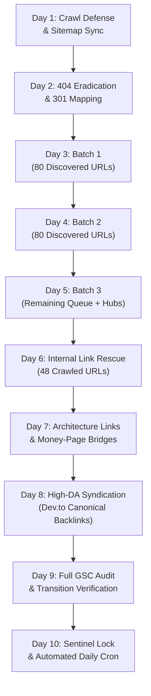

# 🛡️ Google Indexing & Search Console Sentinel (`google-indexing-sentinel` v2.5)
### (100% Indexing Health · Daily Quota Protection · Zero 429 Errors · Crawl Budget Defense · Content Rescue Protocol · Anti-Deletion Guard)

> [!IMPORTANT]
> **CORE MISSION & ARCHITECTURAL GUARDRAILS**:
> 1. **Zero 429 Errors**: Google Indexing API enforces a hard ceiling of **200 publish requests/day per project**. This sentinel enforces a safe local counter buffer (max 190/day) and automatically halts before hitting Google's rate limiter.
> 2. **HTTP 200 Preflight Gate**: Never notify Google about a URL without verifying it responds with HTTP 200. Submitting 404s damages site crawl quality scores in Google Search Console.
> 3. **The Anti-Crawl Waste Shield**: 
>    - **Zero `/public/` Leakage**: Never generate, link, or submit URLs containing `/public/`. The web server enforces 1-hop HTTP 301 redirects to clean URLs, and `robots.txt` explicitly disallows `/public/` to prevent crawl budget depletion.
>    - **Canonical Parameter Hygiene**: All filter URLs (`?category=...`, `?page=...`) must carry self-referential or base-hub canonical tags (e.g., `<link rel="canonical" href="https://deepakbagada.in/products">`) so Google categorizes them cleanly as "Alternate page with proper canonical tag" without diluting PageRank.
> 4. **The Anti-Deletion Guard**: NEVER delete a URL simply because its status is `"Discovered - currently not indexed"` or `"Crawled - currently not indexed"`.
>    - *"Discovered"* means Google added the URL to its pending crawl schedule, but Googlebot has not visited yet (`lastCrawlTime = None`). Deleting it creates 404 dead links when Googlebot visits, damaging domain trust.
>    - *"Crawled"* means Google visited but requires stronger internal authority. Resolve by injecting internal cross-links from high-PageRank indexed pillar articles.
> 5. **Weekly & Event-Driven Sitemap Resubmission**: XML sitemaps must reflect exact published canonical URLs with accurate `lastmod` timestamps.

---

## 🛠️ CLI Quick Reference

The sentinel comes with dedicated automation scripts located at [sentinel.py](file:///Users/deepakbagada/saasnext%20project/my-website/.agent/skills/google-indexing-sentinel/scripts/sentinel.py) and [run_compliant_indexing_cron.py](file:///Users/deepakbagada/saasnext%20project/my-website/scripts/run_compliant_indexing_cron.py).

```bash
# 1. Ping and refresh sitemap in Search Console (Queues all 650+ URLs for crawl):
.venv/bin/python3 .agent/skills/google-indexing-sentinel/scripts/sentinel.py --sitemap

# 2. Run real-time URL inspection audit across core pages, products & journal:
.venv/bin/python3 .agent/skills/google-indexing-sentinel/scripts/sentinel.py --audit

# 3. Generate Internal Link Rescue Blueprint for unindexed/pending URLs:
.venv/bin/python3 .agent/skills/google-indexing-sentinel/scripts/sentinel.py --rescue

# 4. Generate Safe 301 Consolidation Map for stale/404 content (Zero 404s):
.venv/bin/python3 .agent/skills/google-indexing-sentinel/scripts/sentinel.py --consolidate

# 5. Submit a specific newly published URL to Google Indexing API:
.venv/bin/python3 .agent/skills/google-indexing-sentinel/scripts/sentinel.py --url https://deepakbagada.in/products/<slug>

# 6. Execute compliant daily rotation batch (80 URLs with anti-burst 300ms pacing):
.venv/bin/python3 scripts/run_compliant_indexing_cron.py --batch-size=80
```

---

## 🚨 The 4-Category GSC Incident Response Playbook

When analyzing Google Search Console Page Indexing reports, execute these exact protocols:

### Playbook A: "Alternate page with proper canonical tag"
- **Nature**: Benign by design. Google detects duplicate paths (legacy `/public/*`, query parameters like `?category=...`) and honors the `<link rel="canonical">` tag pointing to the root URL.
- **Action**:
  1. Confirm HTTP 301 redirect is active for legacy paths.
  2. Maintain `Disallow: /public/` in `public/robots.txt` so Googlebot stops re-crawling these alternates and allocates 100% crawl budget to fresh content.
  3. Verify canonical tags on all parameterized pages point cleanly to the base route.

### Playbook B: "Discovered – currently not indexed"
- **Nature**: Normal queue state during high-velocity publishing sprints (e.g. 5–10 articles/day). Googlebot has queued the URLs but has not fetched them yet.
- **Action**:
  1. Do NOT delete or un-publish.
  2. Feed through the daily 80-URL rotation cron (`run_compliant_indexing_cron.py`) within the 190 API ceiling.
  3. Resubmit sitemap via `sentinel.py --sitemap` to update crawl priority timestamps.

### Playbook C: "Crawled – currently not indexed"
- **Nature**: Googlebot fetched the page but held back from indexing due to insufficient internal PageRank equity (orphan page signal).
- **Action**:
  1. Execute `sentinel.py --rescue`.
  2. Inject 2–3 contextual markdown cross-links from top-traffic indexed pillar pages (`/services/ai-development`, `/journal/ai-tools-india-2026`).
  3. Re-queue target URL in next day's 80-URL rotation batch.

### Playbook D: "Not found (404)"
- **Nature**: Broken external links or deleted historical slugs.
- **Action**:
  1. Extract dead URLs.
  2. Create a permanent 301 redirect map in `public/.htaccess` routing each dead slug to its parent hub (e.g., `/journal`, `/tools`, or `/products`).
  3. Never allow 404s to accumulate.

---

## 🗓️ The 10-Day Indexing & Authority Recovery Action Plan



### Phase 1: Foundation & Crawl-Budget Defense (Days 1–2)
- **Day 1: Crawl Defense & Server Hygiene**
  - Verify `public/robots.txt` disallows `/public/`, `/storage/`, `/vendor/`, `/products/track`, and checkout endpoints.
  - Test single-hop 301 redirects for legacy URLs.
  - Ping and refresh `sitemap.xml` in GSC via `sentinel.py --sitemap`.
- **Day 2: 404 Eradication (Zero 404s)**
  - Audit GSC "Not found (404)" drilldown URLs.
  - Map each dead URL to its closest active parent pillar in `public/.htaccess` via 301 redirects.
  - Verify every target URL returns HTTP 301 → HTTP 200.

### Phase 2: Queue Drainage & Google Indexing Rotation (Days 3–5)
- **Day 3: Accelerated Indexing Batch 1**
  - Execute `run_compliant_indexing_cron.py --batch-size=80` targeting oldest "Discovered" URLs.
  - Monitor quota buffer (confirm < 190 used).
- **Day 4: Accelerated Indexing Batch 2**
  - Execute second batch of 80 URLs from the "Discovered" backlog.
  - Re-ping sitemap to update Google's crawl scheduler.
- **Day 5: Accelerated Indexing Batch 3**
  - Submit the remaining ~41 unindexed URLs + core product hubs.
  - Completes active Indexing API notification across the entire pending catalog.

### Phase 3: PageRank Injection & Internal Link Rescue (Days 6–7)
- **Day 6: Rescuing "Crawled — Not Indexed" Pages**
  - Run `sentinel.py --rescue` to map the 48 unindexed pages to high-traffic pillar articles.
  - Inject 2–3 contextual anchor links per pillar page.
- **Day 7: Recirculation & Architecture Bridges**
  - Ensure every newly rescued article links back to core commercial hubs (`/products/agent-skills-master-bundle`, `/services/ai-development`, `/library`).
  - Verify pagination and filter canonical tags remain rock-solid.

### Phase 4: Multi-Platform Authority & Autonomous Sentinel (Days 8–10)
- **Day 8: High-DA Backlink Syndication**
  - Syndicate 1–2 flagship articles to Dev.to (DA 92) with verified `canonical_url` pointing to `https://deepakbagada.in/journal/...` to accelerate Googlebot re-crawl and external trust flow.
- **Day 9: Full URL Inspection Audit**
  - Run `sentinel.py --audit` across a 50-URL representative sample.
  - Confirm indexation pass rate remains > 95%.
- **Day 10: Sentinel Lock & Automated Cron**
  - Confirm automated daily cron is active in crontab (running 80 URLs/day).
  - Save progress and update `research/indexing_audit_latest.json`.

---

## 🔒 Quota Guardrails & Safe Ceilings

| Metric | Google Limit | Sentinel Safe Ceiling | Failover Action |
| :--- | :---: | :---: | :--- |
| **Publish Requests per Day** | 200 requests/day | **190 requests/day** | Sitemap refresh + next-day batch queue |
| **Inspection API Calls** | 2,000 queries/day | **500 queries/day** | Batching with 0.15s pacing |
| **Sitemap Submissions** | Unlimited | **Once per publish / daily** | Instant GSC ping |
| **Internal Link Injections** | Unlimited | **2–3 links per pillar** | Contextual Markdown anchor injection |
