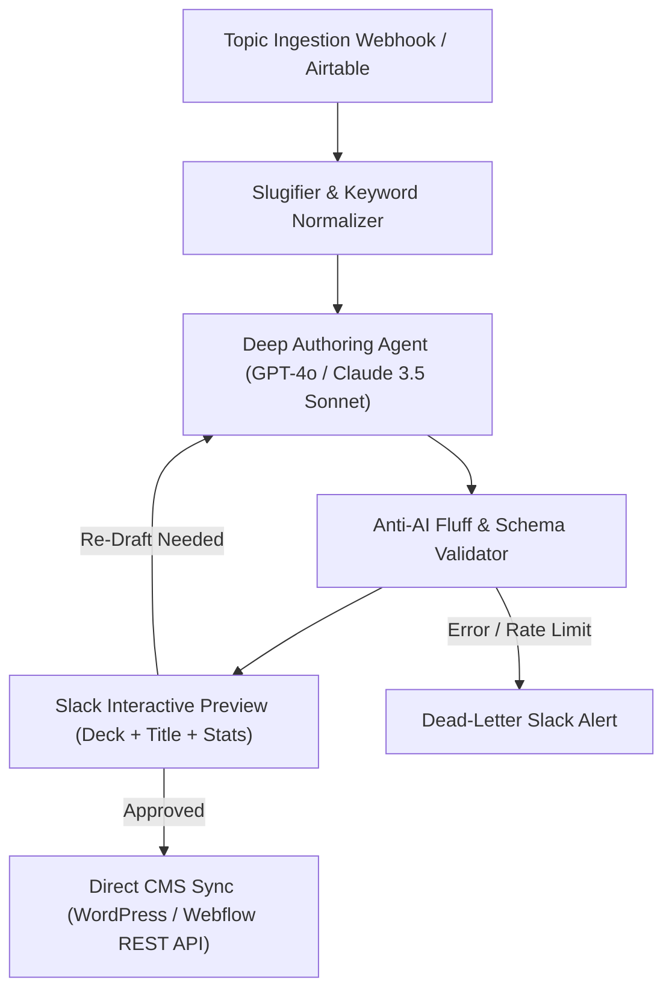

# System Architecture: AI Content Factory Pipeline

**Product:** Autonomous Multi-Agent Content & SEO Publishing Pipeline  
**Slug:** `ai-content-factory-pipeline`  

---

## 1. Multi-Agent Pipeline Topology



---

## 2. Inbound Data Contract

```json
{
  "topic": "Building Resilient Multi-Agent AI Workflows in Production",
  "primaryKeyword": "multi-agent ai workflows",
  "targetAudience": "Principal Engineers & CTOs",
  "wordCountTarget": 1600
}
```

### Response Schema
```json
{
  "status": "completed",
  "jobId": "job_398a1",
  "slug": "multi-agent-ai-workflows",
  "metaTitle": "Multi-Agent AI Workflows: Architecture, Code & Production Scaling",
  "metaDescription": "A complete guide to building production multi-agent AI systems with dead-letter recovery, schema validation, and low latency.",
  "stagedInSlack": true,
  "timestamp": "2026-10-25T11:37:00.000Z"
}
```
