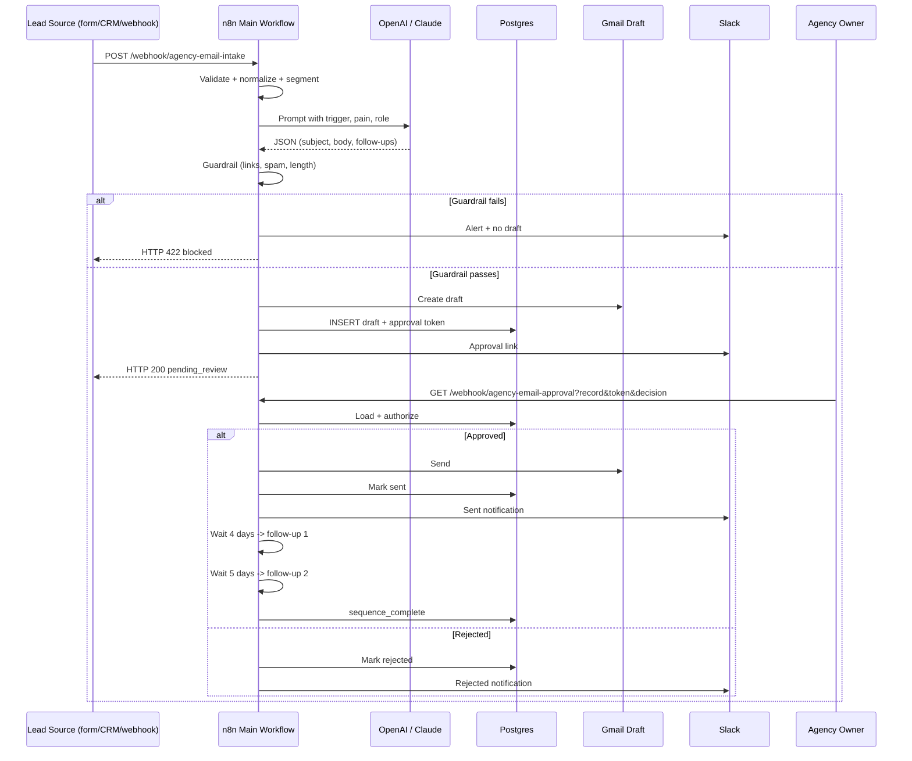
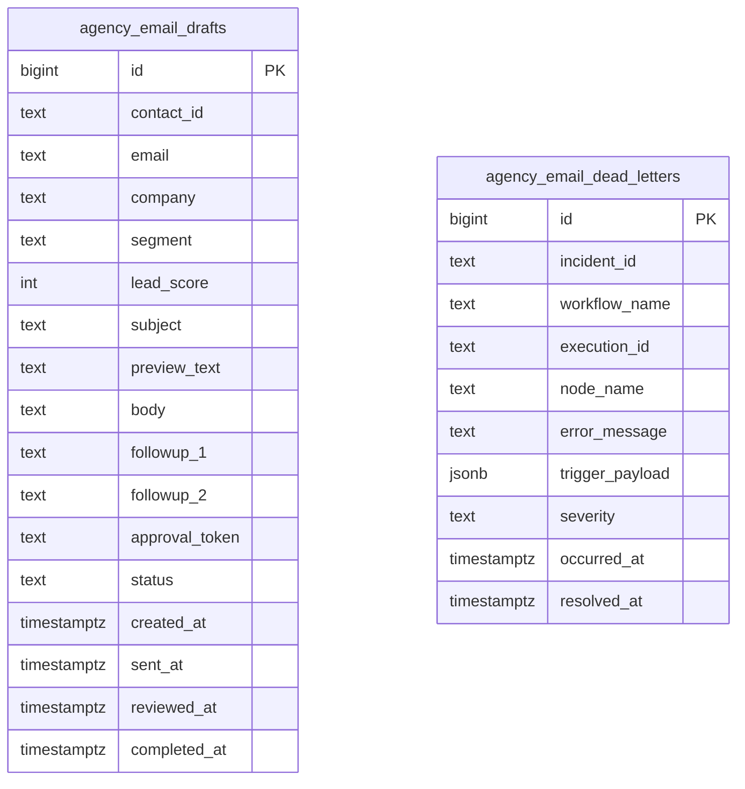

# System Architecture — AI Email Automation for Agencies

## 1. Design goal

Generate a useful, personalized agency email in seconds, but never send it without a human decision. The system separates **drafting** from **sending** so a guardrail failure or an LLM hallucination cannot reach a prospect.

## 2. Sequence diagram



## 3. Workflow inventory

| Workflow | File | Trigger | Output |
| --- | --- | --- | --- |
| Draft & Review | `n8n-agency-email-engine.json` | Webhook POST | Gmail draft, DB record, Slack approval link |
| Approval & Sequence | `n8n-approval-and-sequence.json` | Webhook GET | Sent email, two follow-ups, status updates |
| Error Handler | `n8n-error-handler.json` | Error Trigger | Slack alert, dead-letter row |
| Make Blueprint | `make-agency-email-engine.json` | Custom webhook | Draft + human review (Make equivalent) |

## 4. Input contract

```json
{
  "first_name": "Priya",
  "last_name": "Raman",
  "email": "priya@northstarcollective.in",
  "company": "Northstar Collective",
  "role": "Founder",
  "segment": "agency_team",
  "trigger_event": "hired a new head of delivery last month",
  "pain_point": "every client report is rebuilt by hand each week",
  "notes": "22-person brand agency. Mentioned reporting drag on a podcast.",
  "source": "podcast-research",
  "consent_basis": "legitimate_interest_b2b"
}
```

Required: `email`. Recommended: `first_name`, `company`, `trigger_event`, `pain_point`. Missing optional values fall back to safe defaults.

## 5. AI output contract

```json
{
  "lead_score": 78,
  "segment_label": "agency_team",
  "subject": "the weekly report rebuild",
  "preview_text": "One handoff, one question, no calendar link.",
  "body": "Hi Priya, ...",
  "followup_1": "...",
  "followup_2": "..."
}
```

## 6. Guardrails (enforced in code, not in the prompt)

| Rule | Failure behavior |
| --- | --- |
| Valid email | Reject before the LLM call |
| Subject 1–60 characters | Guardrail blocks |
| No exclamation mark in subject | Guardrail blocks |
| Body 1–130 words | Guardrail blocks |
| No `http://` or `https://` in cold body | Guardrail blocks |
| No Calendly/Cal.com/HubSpot meetings link | Guardrail blocks |
| No spam list phrases | Guardrail blocks |
| Both follow-ups present | Guardrail blocks |
| AI response is valid JSON | Hard error → error workflow |

Dynamic prompt instructions are not a security boundary. The code node is.

## 7. Database schema



Statuses: `pending_review`, `blocked_by_guardrail`, `sent`, `rejected`, `sequence_complete`.

## 8. Security

- Credentials are bound in n8n, never embedded in JSON.
- Approval tokens are random and expire after 7 days.
- The approval query requires both record id and token; a leaked id alone is insufficient.
- Only `pending_review` rows can be approved, preventing duplicate sends.
- The Gmail credential should be a dedicated mailbox, not a personal inbox.
- Restrict n8n public webhook access with a reverse proxy and rate limiting.
- Postgres should not be exposed to the public internet.
- Logs must not contain full email bodies in production if they include personal data.

## 9. Failure modes and recovery

| Failure | Detection | Recovery |
| --- | --- | --- |
| LLM timeout / 429 | n8n node error | Retry 3x with backoff; error workflow alerts |
| Invalid JSON from LLM | Parse code throws | Error workflow; no draft created |
| Gmail OAuth expired | Gmail node 401 | Reconnect credential, rerun execution |
| Postgres unavailable | Node connection error | Error workflow; draft may exist in Gmail, reconcile manually |
| Duplicate approval click | Status check rejects | Respond 500 with “not pending review” |
| Slack down | Slack node error | Email still sends; error workflow should alert by a backup channel |
| Follow-up send fails | Gmail node error | Error workflow; mark sequence for manual review |

## 10. Non-goals

- Not a bulk cold-email blaster.
- Not a deliverability warmup tool.
- Not a CRM replacement.
- Not a legal compliance guarantee.
- Not an autonomous sender. The human approval step is mandatory by design.
