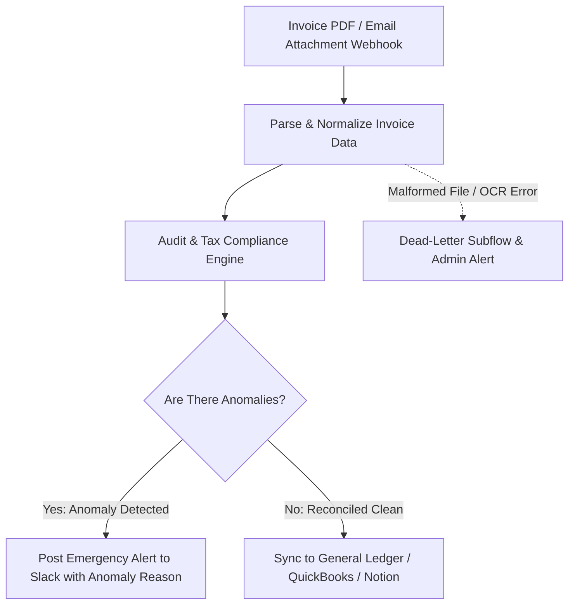

# System Architecture: AI Invoice Recon Sentinel

## Architecture Diagram

## Core Modules
1. **Multi-Modal Document Parsing:** Processes scanned receipts, high-resolution PDFs, and image snapshots.
2. **Tax Engine:** Validates GST (0%, 5%, 12%, 18%, 28%) and international VAT splits.
3. **Threshold Guard:** Automatically routes expenses above $2,500 to executive review before ledger booking.
