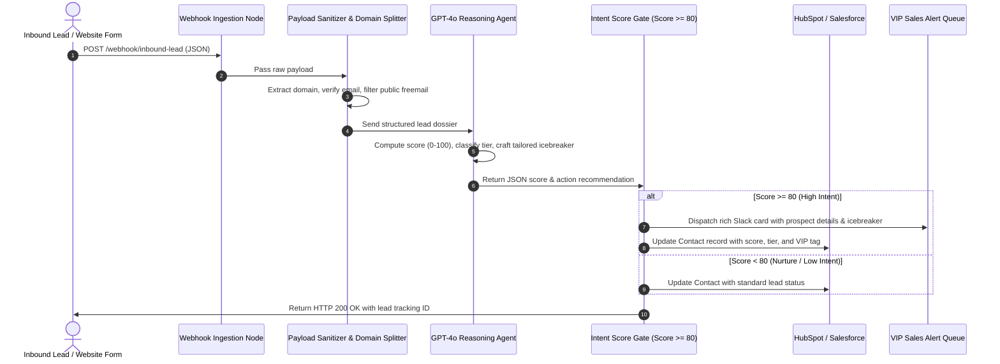

# System Architecture & Technical Specifications

**Product:** AI Inbound Lead Qualification & CRM Auto-Enrichment System  
**Slug:** `ai-lead-intelligence-engine`  

---

## 1. System Topology & Data Flow



---

## 2. Inbound Data Contract & Schema

The inbound webhook listener accepts HTTP POST requests with a `Content-Type: application/json` header:

```json
{
  "name": "Sarah Jenkins",
  "email": "sarah@acmelogistics.com",
  "company": "Acme Logistics Corp",
  "message": "We need to automate 4,000 monthly freight bill triages across 3 warehouse locations."
}
```

### Response Schema
```json
{
  "status": "processed",
  "leadId": "lead_98a7bc21",
  "score": 94,
  "tier": "HOT",
  "action": "INSTANT_DISPATCH",
  "timestamp": "2026-10-25T11:30:00.000Z"
}
```

---

## 3. Reliability & Fault-Tolerance Principles

1. **Zero Secret Leakage:** All API keys (`OPENAI_API_KEY`, `HUBSPOT_ACCESS_TOKEN`) are referenced via secure environment credentials.
2. **Deterministic Fallback:** If the AI model times out or encounters a 429 rate limit, the payload validator logs the lead into the database with a `PENDING_RETRY` status to ensure zero dropped leads.
3. **Idempotency Safeguard:** Prospect email addresses are normalized to lowercase to prevent duplicate CRM record generation.
