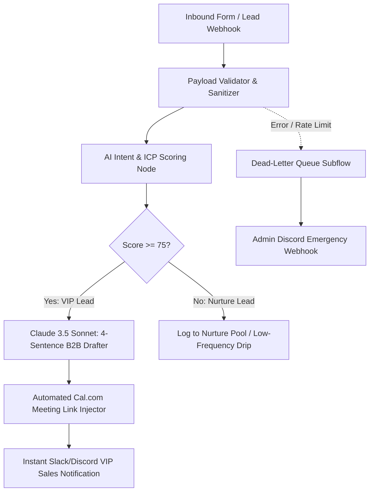

# System Architecture: AI SDR & Inbound Lead Closer

## Architecture Flow Diagram

## Key Modules
1. **Webhook Ingestion (`node-webhook-inbound`):** Accepts standard JSON payloads from Typeform, Webflow, WordPress, Tally, or custom API endpoints.
2. **Payload Sanitizer (`node-payload-validator`):** Trims strings, verifies valid email syntax, strips potential script injections, and formats timestamps.
3. **Intent Evaluator (`node-intent-scorer`):** Analyzes company size indicators, budget keywords, and message urgency to output an ICP score (0-100).
4. **LLM Prompt Layer (`node-claude-drafter`):** Strictly locked 4-sentence prompt template preventing sales fluff, providing direct value, and offering instant booking.
5. **Dead-Letter Safety Net:** Subflow catching HTTP timeouts, API key expirations, or payload schema errors, alerting operations without crashing.
