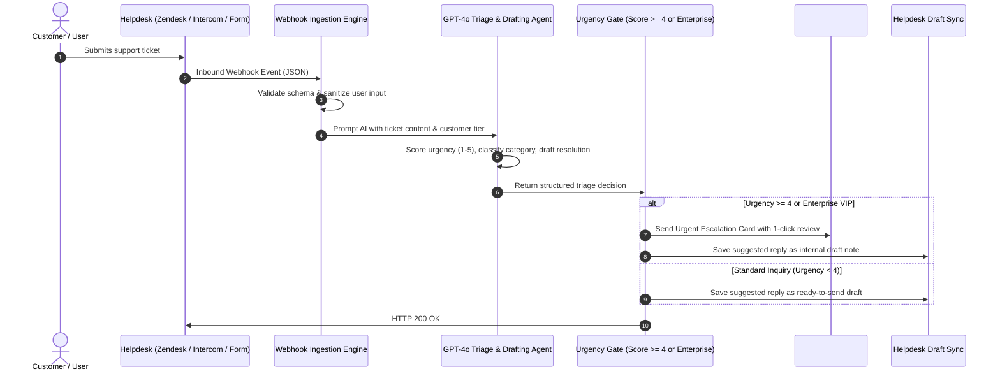

# System Architecture: AI Support Triage Sentinel

**Product:** Autonomous Customer Support & Ticket Escalation Sentinel  
**Slug:** `ai-support-triage-sentinel`  

---

## 1. Sequence & Routing Architecture



---

## 2. Ingestion Data Contract

```json
{
  "ticketId": "TCK-88192",
  "customerEmail": "cto@acmecorp.com",
  "planTier": "ENTERPRISE",
  "subject": "Production API endpoints throwing 504 gateway timeout",
  "description": "Our mobile clients cannot reach the user profile service since 10:45 AM UTC. All payments are failing."
}
```

### Triaged Output Schema
```json
{
  "status": "triaged",
  "ticketId": "TCK-88192",
  "category": "BUG_OUTAGE",
  "urgencyScore": 5,
  "escalated": true,
  "draftedReply": "Hello Acme Corp Team, We have immediately flagged this high-priority production issue to our core infrastructure team...",
  "timestamp": "2026-10-25T11:35:00.000Z"
}
```
