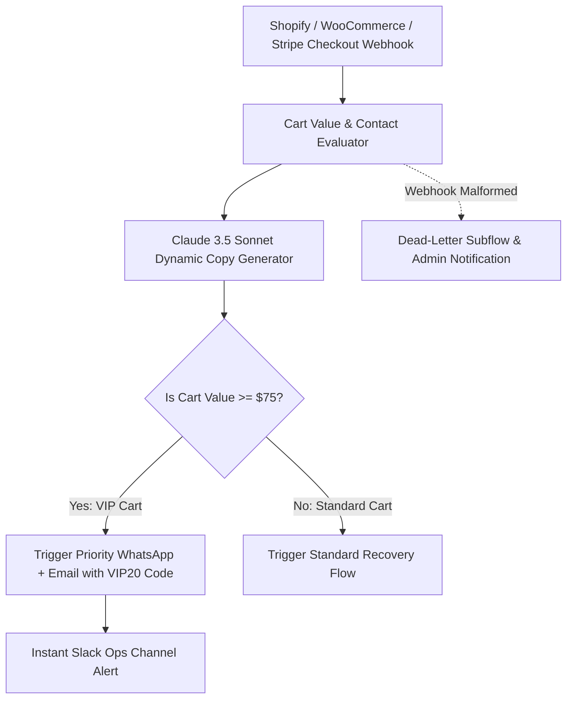

# System Architecture: D2C Retention & Win-Back Bot

## Architecture Diagram

## Functional Components
1. **Event Ingestion:** Listens to `checkouts/create`, `checkouts/update`, and Stripe `checkout.session.expired`.
2. **AI Incentive Engine:** Determines appropriate discount percentage based on cart economics (protecting brand margins).
3. **Dispatch Connectors:** Direct API integration with WhatsApp (via Interakt/Twilio) and transactional email (Resend/SendGrid).
