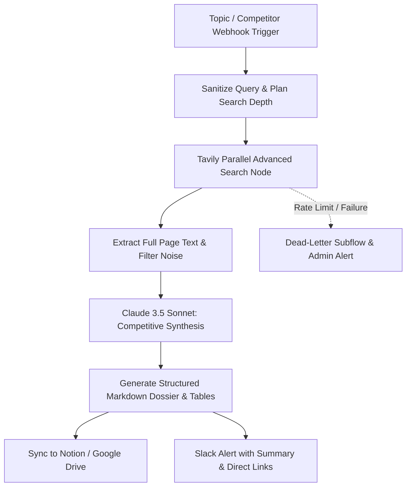

# System Architecture: Deep Research Dossier Engine

## Architecture Flow

## Key Capabilities
- **Anti-Hallucination Citations:** Extracts real URLs and cross-references snippets against page content.
- **Competitor Pricing Tables:** Specifically instructed to isolate SaaS pricing tiers, free trial details, and hidden seat costs.
- **Multi-Format Export:** Formats cleanly for Notion databases, Markdown files, or PDF generation.
