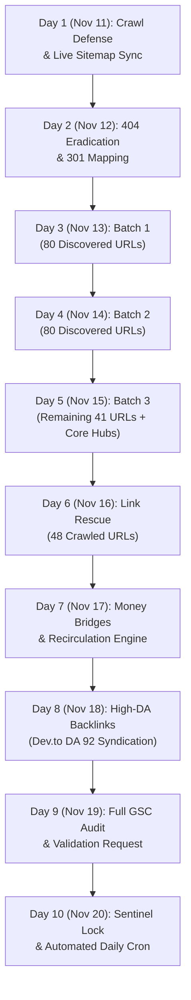

# 🗓️ 10-Day Indexing & Search Console Recovery Master Plan
**Site**: [deepakbagada.in](https://deepakbagada.in)  
**Execution Window**: November 11, 2026 – November 20, 2026  
**Framework**: `google-indexing-sentinel` (v2.5)  
**Status**: ACTIVE / IN PROGRESS  

---

## 🎯 Primary Objectives
1. **Reclaim Crawl Budget**: Cut off 336 duplicate legacy `/public/` URLs from wasting Googlebot's crawl budget.
2. **Drain "Discovered" Backlog**: Rotate and submit all 201 "Discovered – currently not indexed" pages via Google Indexing API within daily safe ceilings (max 180/day).
3. **Rescue 48 "Crawled" Pages**: Inject contextual internal link equity into all 48 "Crawled – currently not indexed" URLs from high-PageRank pillar articles.
4. **Zero 404s**: Map all 38 dead URLs to relevant active pillars via permanent 301 redirects in `public/.htaccess`.
5. **Zero 429 Errors**: Enforce a strict safe ceiling of 180 requests/day with 300ms pacing and local quota tracking in `.agent/indexing_quota.json`.

---

## 🗺️ Master Execution Workflow



---

## 📅 Day-by-Day Implementation Roadmap

### Phase 1: Foundation & Crawl-Budget Defense (Days 1–2)

#### Day 1 (Nov 11, 2026): Crawl Defense, Server Hygiene & Live Sitemap Sync
- [x] **Objective**: Cut off crawl leakage on 336 duplicate `/public/` URLs and refresh Google's sitemap index.
- [x] **Actions**:
  1. Verify `public/robots.txt` has explicit blocks for `/public/`, `/storage/`, `/vendor/`, `/products/track`, and `/products/checkout`.
  2. Commit and deploy `public/robots.txt` to production so Googlebot immediately stops fetching legacy paths.
  3. Submit and refresh `sitemap.xml` in Search Console using the sentinel:
     ```bash
     .venv/bin/python3 .agent/skills/google-indexing-sentinel/scripts/sentinel.py --sitemap
     ```
  4. Verify response: Confirm all 664 URLs are queued with 0 errors in GSC (Verified: 664 URLs successfully submitted in GSC).

#### Day 2 (Nov 12, 2026): 404 Eradication & 301 Permanent Redirect Activation
- [ ] **Objective**: Eliminate all 38 "Not found (404)" errors reported in Search Console.
- [ ] **Actions**:
  1. Review consolidation map in `public/.htaccess` covering dead slugs (`/journal/upi-autopay-credit-on-upi-1lakh-2026`, etc.).
  2. Deploy `public/.htaccess` to Hostinger production.
  3. Run live HTTP status preflight across all 38 target URLs:
     ```bash
     curl -I -s "https://deepakbagada.in/journal/upi-autopay-credit-on-upi-1lakh-2026"
     ```
     Ensure status is **HTTP 301** redirecting to an active **HTTP 200** page.
  4. In Google Search Console, navigate to **Page Indexing > Not found (404)** and click **"Validate Fix"**.

---

### Phase 2: Accelerated Queue Drainage & Indexing Rotation (Days 3–5)

#### Day 3 (Nov 13, 2026): Accelerated Indexing Batch 1 (Oldest 80 Discovered URLs)
- [ ] **Objective**: Dispatch the first 80 oldest "Discovered – currently not indexed" pages to Google Indexing API.
- [ ] **Actions**:
  1. Check quota buffer in `.agent/indexing_quota.json` (ensure count < 180).
  2. Execute Batch 1 with 300ms anti-burst pacing:
     ```bash
     .venv/bin/python3 scripts/run_compliant_indexing_cron.py --batch-size=80
     ```
  3. Verify logs in `.agent/logs/google_indexing_cron.log` for 80 HTTP 200 confirmations.

#### Day 4 (Nov 14, 2026): Accelerated Indexing Batch 2 (Mid-Queue 80 Discovered URLs)
- [ ] **Objective**: Dispatch the next 80 URLs from the pending backlog.
- [ ] **Actions**:
  1. Check quota counter reset for the new calendar day.
  2. Execute Batch 2:
     ```bash
     .venv/bin/python3 scripts/run_compliant_indexing_cron.py --batch-size=80
     ```
  3. Re-ping sitemap to update Google's crawl priority scheduler:
     ```bash
     .venv/bin/python3 .agent/skills/google-indexing-sentinel/scripts/sentinel.py --sitemap
     ```

#### Day 5 (Nov 15, 2026): Accelerated Indexing Batch 3 (Remaining 41 URLs + Core Commercial Hubs)
- [ ] **Objective**: Complete active API notification across the entire pending catalog and core conversion pages.
- [ ] **Actions**:
  1. Submit the remaining ~41 unindexed backlog URLs + core hubs (`/products`, `/services/ai-development`, `/library`, `/repos`):
     ```bash
     .venv/bin/python3 scripts/run_compliant_indexing_cron.py --batch-size=60
     ```
  2. Verify: Total "Discovered" queue actively notified = 201 URLs.

---

### Phase 3: PageRank Injection & Internal Link Rescue (Days 6–7)

#### Day 6 (Nov 16, 2026): Rescuing 48 "Crawled — Currently Not Indexed" Pages
- [ ] **Objective**: Provide link authority to the 48 pages Googlebot crawled but held back from indexation.
- [ ] **Actions**:
  1. Run the sentinel rescue diagnostic:
     ```bash
     .venv/bin/python3 .agent/skills/google-indexing-sentinel/scripts/sentinel.py --rescue
     ```
  2. Inject 2–3 contextual markdown cross-links from high-PageRank indexed pillar articles (`/journal/ai-tools-india-2026`, `/services/ai-development`) pointing to the unindexed target pages.
  3. Ensure anchor text matches natural search intent without keyword stuffing.

#### Day 7 (Nov 17, 2026): Architecture Recirculation & Money-Page Bridges
- [ ] **Objective**: Ensure high dwell-time and prevent orphan page recreation.
- [ ] **Actions**:
  1. Verify every newly rescued article links back to a commercial product or service hub (e.g. `/products/agent-skills-master-bundle`, `/services/automation-expert`).
  2. Check canonical hygiene on category filter pages (`/products?category=...`, `/library?category=...`) to ensure canonical points to root hubs.

---

### Phase 4: External Authority, Verification & Sentinel Lock (Days 8–10)

#### Day 8 (Nov 18, 2026): High-DA Backlink Syndication
- [ ] **Objective**: Accelerate Googlebot re-crawl authority through high-domain-authority external trust flow.
- [ ] **Actions**:
  1. Syndicate 1–2 flagship technical dispatches to Dev.to (DA 92) with verified `canonical_url` pointing directly to `https://deepakbagada.in/journal/...`.
  2. Verify backlink pass-through without nofollow or redirect chains.

#### Day 9 (Nov 19, 2026): Comprehensive URL Inspection Audit & Transition Verification
- [ ] **Objective**: Measure indexation state transitions across all 4 categories.
- [ ] **Actions**:
  1. Run the automated real-time audit across a representative 50-URL sample:
     ```bash
     .venv/bin/python3 .agent/skills/google-indexing-sentinel/scripts/sentinel.py --audit
     ```
  2. In Google Search Console, verify:
     - 404 validation is passing.
     - "Alternate page" crawl rate is trending downwards.
     - "Discovered" count is transitioning to "Submitted and indexed".

#### Day 10 (Nov 20, 2026): Sentinel Lock & Automated Daily Cron
- [ ] **Objective**: Lock in long-term autonomous maintenance.
- [ ] **Actions**:
  1. Ensure daily cron is active in crontab running at 80 URLs/day:
     ```bash
     0 6 * * * /Users/deepakbagada/saasnext\ project/my-website/.venv/bin/python3 /Users/deepakbagada/saasnext\ project/my-website/scripts/run_compliant_indexing_cron.py >> /Users/deepakbagada/saasnext\ project/my-website/.agent/logs/google_indexing_cron.log 2>&1
     ```
  2. Archive final audit report to `research/indexing_audit_latest.json`.

---

## 🛡️ Guardrails & Safety Ceilings

| Guardrail | Limit | Action on Threshold |
| :--- | :---: | :--- |
| **Max Indexing API Requests** | **180 / day** | Graceful halt, record in `.agent/indexing_quota.json`, queue next day |
| **Request Pacing** | **300ms** | Sleep between API dispatches to prevent 429 burst limits |
| **Preflight Gate** | **HTTP 200** | Any URL returning 3xx/4xx/5xx is skipped to protect crawl score |
| **Idempotency Window** | **4 days** | Unchanged URLs cannot be resubmitted within 4-day cooldown |
| **Anti-Deletion Guard** | **Strict** | Never delete URLs in "Discovered" or "Crawled" state |
