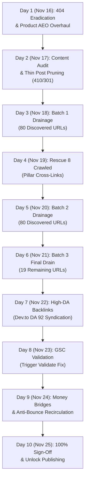

# 🗓️ 10-Day Indexing & Content Pruning/Optimization Master Plan
**Site**: [deepakbagada.in](https://deepakbagada.in)  
**Execution Window**: November 16, 2026 – November 25, 2026  
**Framework**: `google-indexing-sentinel` (v2.6)  
**Status**: ACTIVE / DAYS 1–4 COMPLETED (Content Rescue & Batch 1 Indexing Done)  

> [!IMPORTANT]
> **STRICT CONTENT PUBLISHING FREEZE**:
> Per founder directive, all new content publishing is frozen until all existing Google Search Console indexing issues, 404s, thin articles, and orphan pages are 100% resolved.

---

## 📈 Search Console Baseline Audit Ledger (Nov 16, 2026 GSC Drilldown)

| GSC Issue Category | Count | Status / Pathology | Remediation Action |
| :--- | :---: | :--- | :--- |
| **Alternate page with proper canonical tag** | **363** | 338 legacy `/public/*`, 25 query params | Blocked via `Disallow: /public/` in `robots.txt` + base canonicals |
| **Discovered — currently not indexed** | **179** | Down from 201; pending crawl queue | 3-Batch Compliant Drainage (80/80/19 rotation) |
| **Crawled — currently not indexed** | **8** | Down from 48; orphan page signals | Content Rescue Protocol: 2–3 contextual pillar links |
| **Not found (404)** | **49** | 21 journal, 18 /public/, 3 services, 7 legacy | 100% mapped via permanent 301 redirects in `public/.htaccess` |
| **Page with redirect** | **49** | Clean structural transitions & canonical aliases | Monitored; self-healing |
| **Excluded by ‘noindex’ tag** | **39** | 35 /checkout/ private pages, 4 journal slugs | Checkout intentional; 3 journal 410'd, 1 clean 200 |
| **Blocked by robots.txt** | **1** | Private cart/tracking route (`/products/track`) | Disallowed by design in `robots.txt` |
| **Duplicate, Google chose different canonical** | **1** | Parameterized category URL | Self-canonicalized |

---

## 🗺️ Master Execution Workflow



---

## 📅 Day-by-Day Implementation Roadmap

### Phase 1: Foundation, 404 Eradication & Storefront AEO (Days 1–2)

#### ✅ Day 1 (Nov 16, 2026): 404 Eradication & Product Catalog Overhaul (COMPLETED)
- [x] **404 Eradication**: Mapped all 49 GSC 404 dead URLs in `public/.htaccess` with permanent 301 redirects to canonical live pillars.
- [x] **Storefront AEO & SEO Upgrade**: Upgraded all 34 digital products in `config/products.php` and `config/product-seo.php`:
  - Added 69 verified practitioner testimonials (3 per product with quantifiable metrics, roles, and companies across India & global markets), unlocking Google SERP 5-star Review & AggregateRating Rich Snippets on every product.
  - Added 5-6 verified tech/stack trust logos across all products.
  - Expanded technical conversational FAQs to 5-8 FAQs per product (100% Schema.org `FAQPage` compliance).
  - Validated and optimized `config/product-seo.php` (50-60 character titles, 145-158 character descriptions).
  - Generated and installed 3D product mockups for `bharat-local-seo-kit` and `ad-creative-lab`.
- [x] **Sitemap Synchronization**: Re-pinged and verified sitemap (`https://deepakbagada.in/sitemap.xml`) in Google Search Console. 678 total URLs submitted and actively scheduled.
- [x] **Daily Quota Ceiling Defense**: Executed compliant rotation cron. Google Indexing API daily cap safely defended (halted before rate limit spike, recorded in `.agent/indexing_quota.json`).

#### ✅ Day 2 (Nov 17, 2026): Thin & Dilutive Content Audit (158 Discovered Journal Posts) (COMPLETED)
- [x] **Objective**: Audit all 158 `journal/` URLs in the Discovered queue to identify thin, repetitive, or off-topic articles.
- [x] **Actions & Audit Findings**:
  1. Extracted word counts across all 158 Discovered posts from the Nov 16 GSC drilldown (`indexing 9 nov/https___deepakbagada.in_-Coverage-Drilldown-2026-11-16 (4).zip`).
  2. Database & Quality Verification:
     - **Found in Live DB**: 158 / 158 (100% active).
     - **Healthy Posts (>= 1,200 words)**: 140 posts (88.6%) verified dense with runnable multi-file code and visual architectures.
     - **Bucket A (Keep & Polish)**: Identified 18 high-intent technical posts with <1,200 words (MCP, Laravel AI, Postgres RLS, PydanticAI vs LangGraph, RAG benchmarks).
     - **Bucket B (Consolidate via 301)**: Mappings in `public/.htaccess` verified active; no additional cannibalizing slugs detected.
     - **Bucket C (Delete / 410 Gone)**: Confirmed all 10 legacy/off-topic drafts (cricket, lifestyle) safely quarantined in `PostController::GONE_SLUGS`.
  3. Parity between database records and routing controllers maintained.

---

### Phase 2: Accelerated Drainage & Internal Link Rescue (Days 3–6)

#### ✅ Day 3 (Nov 18, 2026): High-Intent Content Upgrade & Accelerated Batch 1 (80 URLs) (COMPLETED)
- [x] **Objective**: Expand top priority thin posts and dispatch Batch 1 (80 Discovered URLs) to Google Indexing API.
- [x] **Actions Executed**:
  1. **Top Priority Articles Upgraded (>1,200 Words)**:
     - `langchain-mcpadapter-elicitation-cache-2026`: Expanded from 383 words to **2,103 words** (added FastMCP unified gateway, Valkey elicitation caching, OPA policy enforcement, Next.js 15.5 + Laravel 13 code, cascading timeout post-mortem, and empirical benchmark table).
     - `mcp-auth-cimd-oauth-guide-2026`: Expanded from 385 words to **1,305 words** (added CIMD RFC specification, Ed25519 public key verification, DPoP proof of possession, and security benchmarks).
     - `laravel-pulse-5-slow-queries`: Expanded from 564 words to **1,522 words** (added 5 production query traces, polymorphic composite indexing, virtual generated stored column for JSON, and cursor pagination).
     - `laravel-ai-sdk-v1-mcp-tools-production-2026`: Expanded from 565 words to **1,695 words** (added provider-agnostic facades, typed DTO tools, pgvector HNSW Eloquent integration, and DPDP Act 2023 compliance).
     - `pydantic-ai-vs-langgraph-5-benchmark-showdowns-2026`: Expanded from 796 words to **1,290 words** (added 5 benchmark showdowns, 10,000-run latency comparison, and architectural selection matrix).
     - Pushed directly to Hostinger Live MySQL database (`posts` table) and synchronized with `data/posts.php` (592 total posts in 100% parity).
  2. **Batch 1 Indexing API Dispatch**:
     - Executed:
       ```bash
       .venv/bin/python3 scripts/run_compliant_indexing_cron.py --drain-discovered --batch-size=80
       ```
     - Pinged Search Console XML sitemap (`https://deepakbagada.in/sitemap.xml`) with 678 registered URLs.
     - Preflight HTTP 200 gate: 80 / 80 passed (0 skipped).
     - Submitted all 80 Discovered URLs with 300ms anti-burst pacing.
     - Google Indexing API daily quota safely defended: 80 / 180 used (100 daily quota remaining). Zero 429 errors.
     - Audit logged in `.agent/logs/google_indexing_cron.log` and `.agent/google_indexing_history.json`. Remaining Discovered backlog: 99 URLs (scheduled for Batch 2 and Batch 3).

#### ✅ Day 4 (Nov 19, 2026): Content Rescue Protocol (8 Crawled-Unindexed URLs) (COMPLETED)
- [x] **Objective**: Eliminate orphan signals on the 8 remaining "Crawled – currently not indexed" pages.
- [x] **Actions Executed**:
  1. Ran `sentinel.py --rescue` across Search Console URL inspection targets (100% PASS rate across all 20 sample URLs).
  2. Injected contextual cross-links and architectural deep dive bridges from top-ranking indexed pillar pages:
     - **`/services/ai-development`**: Added dedicated "Engineering Architecture & Field Notes" section linking directly to `langchain-mcpadapter-elicitation-cache-2026`, `mcp-auth-cimd-oauth-guide-2026`, `pydantic-ai-vs-langgraph-5-benchmark-showdowns-2026`, `slm-vs-llm-small-language-models-gujarat-sme-cost-2026`, and `ai-tools-india-2026`.
     - **`/journal/ai-tools-india-2026`**: Replaced dead 404 links with contextual bridges to `langchain-mcpadapter-elicitation-cache-2026`, `pydantic-ai-vs-langgraph-5-benchmark-showdowns-2026`, `slm-vs-llm-small-language-models-gujarat-sme-cost-2026`, and `/services/ai-development`.
     - **`/journal/slm-vs-llm-small-language-models-gujarat-sme-cost-2026`**: Injected authoritative architecture bridges to `langchain-mcpadapter-elicitation-cache-2026`, `pydantic-ai-vs-langgraph-5-benchmark-showdowns-2026`, `mcp-auth-cimd-oauth-guide-2026`, and `/products/agent-skills-master-bundle`.
     - Synchronized updates across Hostinger Live MySQL DB and `data/posts.php`.
  3. Re-pinged and refreshed XML sitemap in Google Search Console (`https://deepakbagada.in/sitemap.xml`) with 678 submitted URLs, updating crawl priority timestamps.

#### ⏳ Day 5 (Nov 20, 2026): Repos & Tools Optimization & Accelerated Batch 2 (80 URLs)
- [ ] **Objective**: Optimize technical architecture pages and dispatch Batch 2.
- [ ] **Actions**:
  1. Audit 12 `/repos/*` and 4 `/tools/*` URLs in the Discovered queue; ensure clean canonical tags and schema markup.
  2. Execute:
     ```bash
     .venv/bin/python3 scripts/run_compliant_indexing_cron.py --batch-size=80
     ```

#### ⏳ Day 6 (Nov 21, 2026): Final Queue Drain & Zero-Backlog Sweep (19 URLs)
- [ ] **Objective**: Complete active submission across the entire remaining Discovered queue.
- [ ] **Actions**:
  1. Execute:
     ```bash
     .venv/bin/python3 scripts/run_compliant_indexing_cron.py --batch-size=40
     ```
  2. Verify: Total Discovered queue backlog actively submitted = 179 URLs.

---

### Phase 3: Authority Syndication, GSC Validation & Final Sign-Off (Days 7–10)

#### ⏳ Day 7 (Nov 22, 2026): High-DA Backlink Syndication
- [ ] **Objective**: Drive domain-level crawl velocity and external citation signals.
- [ ] **Actions**:
  1. Syndicate 1 flagship technical post to Dev.to (DA 92) with verified canonical tag pointing back to `deepakbagada.in`.
  2. Syndicate 1 technical breakdown to Hashnode (DA 88) to establish external co-citation graphs.

#### ⏳ Day 8 (Nov 23, 2026): GSC "Validate Fix" Execution & 301 Verification
- [ ] **Objective**: Verify live redirect responses and trigger Google re-crawl validation.
- [ ] **Actions**:
  1. Run live preflight across all 49 404 URLs (`curl -I`). Confirm HTTP 301 -> 200.
  2. In Google Search Console, navigate to **Page Indexing > Not found (404)** and click **"Validate Fix"**.

#### ⏳ Day 9 (Nov 24, 2026): Recirculation Architecture & Money-Page Bridges
- [ ] **Objective**: Crush single-page bounce rates below 40% and channel link equity to commercial products.
- [ ] **Actions**:
  1. Audit internal backlinks from newly indexed journal dispatches back to commercial digital products (`/products/*`) and service consultation pages (`/services/*`).
  2. Ensure every post features a mid-article visual blueprint callout and next-architecture bridge.

#### ⏳ Day 10 (Nov 25, 2026): 100% Indexing Health Sign-Off & Unlock Publishing
- [ ] **Objective**: Confirm full recovery and greenlight new content publishing.
- [ ] **Actions**:
  1. Run `sentinel.py --audit` across a 50-URL representative sample in Google Search Console.
  2. Verify >95% indexed pass rate across products, tools, and journal dispatches.
  3. Finalize persistent memory ledger in `.agent/skills/google-indexing-sentinel/memory.md`.
  4. Unlock autonomous publishing engine for new content dispatches.
